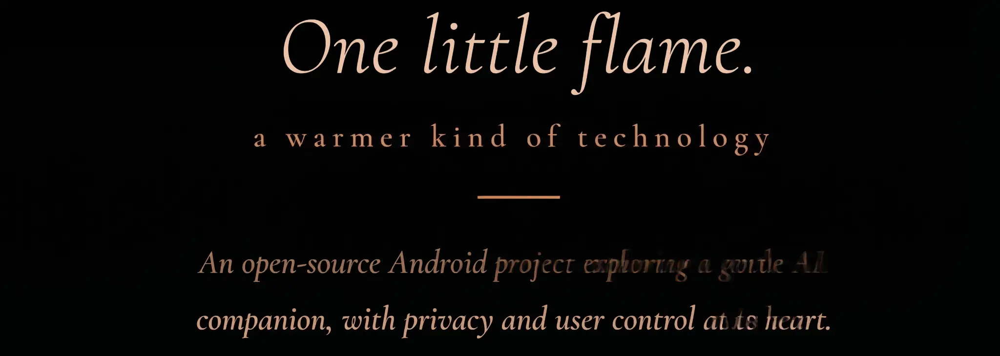
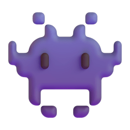

<div align="center">


<br/>
<picture>
  <source media="(prefers-color-scheme: dark)" srcset="docs/assets/glimmer-flame-definition-dark.png"/>
  <source media="(prefers-color-scheme: light)" srcset="docs/assets/glimmer-flame-definition-light.webp"/>
  
</picture>

<br/>


### *Not just an AI assistant — a friend that lives on your screen.*

[](LICENSE)
[](https://developer.android.com)
[](#platforms)
[](#platforms)
[](#project-status)

[**Why Glimmer**](#why-glimmer-exists) · [**Status**](#project-status) · [**Features**](#features) · [**Companions**](#companions) · [**Platforms**](#platforms) · [**Architecture**](#architecture) · [**Getting started**](#getting-started) · [**GlimmerSoul**](#glimmersoul-format) · [**Privacy & safety**](#privacy-and-safety) · [**Roadmap**](#roadmap) · [**Full plan**](ROADMAP.md) · [**Contributing**](#contributing) · [**License**](#license)

<sub>Animated star-struck emoji by <a href="https://googlefonts.github.io/noto-emoji-animation/">Google Noto Emoji</a>, licensed under <a href="https://creativecommons.org/licenses/by/4.0/">CC BY 4.0</a>.</sub>

</div>

---

## What is Glimmer?

Glimmer is an open-source **AI companion layer**: a small, animated character designed to float above your apps, chat in your language, keep you company, and help with everyday tasks such as opening apps, searching, setting reminders, and automating routines.

Choose the companion that feels right to you: a calm sage, a playful trickster, a curious explorer, a gentle empath, and more. Anyone can create new companions using the open **GlimmerSoul** format.

Glimmer follows a **hybrid AI design**. Small models run on your device for speed and everyday privacy, while a connected cloud service provides stronger reasoning, higher-quality translation, and real-time information.

---

## Project status

Glimmer is in **early development**, built by one developer in spare time. There is **no public release yet**. The labels below distinguish active work from planned ideas and areas still under research.

| Status | Meaning |
|:--|:--|
| **In progress** | Work is underway |
| **Planned** | Intended, but not yet in progress |
| **Research** | Desired, but feasibility has not yet been proven |

Developers, designers, translators, accessibility specialists, and AI researchers are welcome. See [Contributing](#contributing) to get involved.

---

## Why Glimmer exists

Many people spend a large part of their day on screens, and conversations with AI are becoming familiar. Glimmer accepts that reality and aims to make a screen-based companion kinder, more useful, and more respectful.

The project is being designed with people in mind who are often underserved by mainstream apps:

- People who live alone and want someone to talk to
- Children who need a patient, safe way to learn and play
- People with disabilities; the WHO estimates that about 1.3 billion people live with a significant disability
- Migrants and language learners; the UN estimates about 281 million international migrants
- Anyone who wants a friendly, personal assistant rather than a cold one

Glimmer is not a doctor, therapist, or lawyer, and it does not claim to be one. See [Privacy and safety](#privacy-and-safety).

---

## Features

### Companion and personality

| Feature | Status |
|---|:--:|
| Animated flame companion that floats above your apps | In progress |
| Nine built-in companions with distinct personalities | In progress |
| GlimmerSoul, an open format to create, share, and export companions | In progress |
| Friendly chat: banter, stories, games, and bedtime stories | Planned |
| Language practice with gentle corrections | Planned |
| 100+ languages with automatic detection; quality varies by language and is best with cloud support | Planned |
| Companion memory for your preferences, with a one-tap “forget” control | Planned |

### Everyday help

| Feature | Status |
|---|:--:|
| Natural-language commands in many languages, such as “open Maps,” “search for…,” or “set an alarm for 7” | Planned |
| Reminders, calendar support, daily routines, and habit or medication-time reminders | Planned |
| Optional summaries of notifications and messages; requires notification access | Planned |
| Task automation and multi-step routines | Planned |
| Voice control and offline speech recognition with Whisper.cpp | Planned |
| Draft replies for you to review before sending | Planned |
| Android phone tools: duplicate-photo detection, storage cleanup, and permission audits | Planned |
| Elevated actions through [Shizuku](https://shizuku.rikka.app/), with no root required | Planned |

### Context and wellbeing

| Feature | Status |
|---|:--:|
| Context-aware suggestions based on time of day, calendar, battery, and long sessions | Planned |
| Gentle check-ins, break reminders, and late-night nudges | Planned |
| Daily gratitude and kindness prompts | Planned |
| Optional check-in summaries for trusted contacts, visible to and controlled by the user | Planned |
| User-triggered emergency button that shares location with trusted contacts | Planned |

### Accessibility

| Feature | Status |
|---|:--:|
| Full voice control and screen reading | Planned |
| Large, simplified interface mode | Planned |
| Sign-language input from the camera | Research |

### Culture, family, and the world

| Feature | Status |
|---|:--:|
| Heritage Keeper: an opt-in archive for family stories, dialects, and proverbs | Planned |
| Pet and nature features: vet and feeding reminders, weather alerts, and nature facts | Planned |
| Eco-habit tracking for water, movement, and simple carbon estimates | Planned |
| Community marketplace for companion Souls | Planned |

> **Not a medical device.** Glimmer does not diagnose, monitor health conditions, interpret symptoms, or provide medication advice. Reminder features only remind you about something you or your doctor decided.

---

## Companions

Nine companions are planned for the first release. Each one is defined by a `.soul.json` file.

<p align="center">
  
</p>

| Companion | Archetype | Voice | Best for |
|---|---|---|---|
| **Nox** | The Wise Sage | Brief, precise | Focus and minimalism |
| **Zuri** | The Trickster | Sarcastic, playful | Gamers and social people |
| **Pip** | The Explorer | Excited, curious | Kids and creatives |
| **Kael** | The Warrior | Direct, no fluff | Productivity and athletes |
| **Luna** | The Empath | Soft, checks in | Warm daily company |
| **Gaia** | The Earth Guardian | Gentle, poetic | Nature and eco habits |
| **Seraph** | The Child’s Friend | Patient, playful | Children, with a parent or guardian |
| **Elder** | The Keeper of Memory | Warm, nostalgic | Stories and family memories |
| **Dawa** | The Routine Helper | Calm, clear | Reminders and daily routines |

The same request can sound different with each companion. For example: “Remind me about the meeting at 3 PM.”

- **Nox:** “Meeting. 3 PM. Set.”
- **Zuri:** “Fine, I’ll save you from forgetting again — done.”
- **Pip:** “A meeting! Reminder set. Want one 15 minutes early too?”
- **Luna:** “Of course. I’ll remind you gently.”

Anyone can create companions using [GlimmerSoul](#glimmersoul-format).

---

## Platforms

| Platform | Status | Notes |
|---|:--:|---|
| **Android 15+** | In progress | Primary platform: overlay companion, tasks, and voice |
| **Windows** | Planned | Desktop companion, PC control, and automation |
| **Linux** | Planned | Similar to Windows, starting with common desktop environments |
| **iOS / macOS** | Later | Planned after Android, Windows, and Linux. Apple platforms restrict floating overlays and background access, so the experience will differ. |

---

## Architecture

Glimmer uses a **hybrid** design:

```
┌─────────────────────────── Your device ───────────────────────────┐
│  Companion UI · Soul engine · Task router · Encrypted local memory │
│  Small local models: quick chat, language detection, speech (STT)  │
└───────────────┬───────────────────────────────────────────────────┘
                │  TLS 1.3 · only what each feature needs
┌───────────────▼───────────────────────────────────────────────────┐
│  Cloud service: stronger reasoning, translation, live information, │
│  and optional sync of your companion between devices                │
└────────────────────────────────────────────────────────────────────┘
```

- **Local for simple tasks.** Quick replies, commands, and language detection use on-device models.
- **Cloud for harder tasks.** Complex reasoning, higher-quality translation, and sync use the cloud.
- **Model size adapts to your device.** Glimmer selects a local model that fits your RAM. Real benchmarks will be published once they have been measured on actual devices.

### Repository layout

```
glimmer/
├── android/      # Kotlin app (overlay, tasks, voice)
├── desktop/      # Windows and Linux app (planned)
├── shared/       # AI bindings (llama.cpp, Whisper.cpp), Soul parser, language detection
├── souls/        # Built-in and community companions
├── docs/         # Architecture, plugin API, Soul format, privacy
└── skins/
```

### Tech stack

| Layer | Android | Desktop (Windows / Linux) |
|---|---|---|
| Language | Kotlin · C++ (NDK) | To be decided |
| UI | Jetpack Compose + custom Canvas | Transparent always-on-top window |
| Local AI | llama.cpp · ONNX Runtime | llama.cpp |
| Speech | Whisper.cpp | Whisper.cpp |
| Storage | Room + AES-256 + Android Keystore | Encrypted local store |
| Background | WorkManager + AlarmManager | System service / tray |
| System access | Shizuku (optional) | OS automation APIs |

---

## Getting started

### Android (current development target)

**Prerequisites:** Android Studio Jellyfish or newer, Android SDK 35+, JDK 17+, and a device or emulator running Android 15+.

```bash
git clone https://github.com/glimmer-ai/glimmer.git
cd glimmer/android
./gradlew assembleDebug
./gradlew installDebug
```

On first launch:

1. Grant overlay permission (`SYSTEM_ALERT_WINDOW`) when prompted.
2. Complete **Privacy Setup** and choose what Glimmer may access and which features may use the cloud.
3. Select **Summon Glimmer**, then choose a companion.
4. Optionally enable [Shizuku](https://shizuku.rikka.app/) for system features.

Windows and Linux build instructions will be added when those builds exist.

---

## GlimmerSoul format

A **GlimmerSoul** is a small JSON file that describes a companion. The format is open (**CC0**) so anyone can create and share companions.

```json
{
  "version": "1.0",
  "id": "luna",
  "name": "Luna",
  "archetype": "The Empath",
  "author": "Glimmer Core Team",
  "license": "CC0-1.0",
  "language": "auto",
  "avatar": { "shape": "flame", "colorPrimary": "#FFD54F" },
  "personality": { "humor": 0.5, "warmth": 1.0, "energy": 0.6, "formality": 0.2 },
  "skills": { "task_execution": 0.7, "emotional_support": 1.0, "ambient_awareness": 0.9 },
  "special_skill": { "id": "checkin_mode", "name": "Check-in Mode" },
  "responses": {
    "greeting": { "en": ["Hi there!"], "ar": ["أهلاً بك!"], "fallback": ["Hello!"] }
  }
}
```

A Soul can define personality, skill weights, voice and vocabulary, a special mode, visual identity, multilingual responses, and content filters for its intended audience.

To publish a Soul, follow [the GlimmerSoul format guide](docs/GLIMMERSOUL_FORMAT.md) and open a PR to [`souls/`](souls/).

---

## Privacy and safety

Because Glimmer can connect to a cloud service, this section explains the project’s stated commitments and planned user controls.

### What we commit to

- **No selling of personal data.** This is a project policy and commitment; the open-source license alone does not enforce it.
- **Data minimization:** each feature sends only what it needs.
- **Encryption:** TLS 1.3 in transit and AES-256 for data stored on your device.
- **Control:** view what is stored, export it in an open format, and delete it all with one action.
- **Granular consent:** cloud features, memory, sync, and the Heritage archive are separate opt-ins that can be revoked.
- **Open source:** the code can be audited, and modified network versions must publish their source under AGPL-3.0.

### Consent levels

| Level | Examples | Can be disabled? |
|---|---|:--:|
| Essential | Core on-device AI and UI | Required |
| Optional | Conversation memory and personalization | Yes |
| Cloud | Cloud AI, translation, sync, and Heritage archive | Yes, per feature |
| Experimental | Beta features and research participation | Yes; off by default |

### Safety boundaries

- **No medical functions.** Glimmer is not a medical device and does not diagnose, interpret symptoms, or provide medication advice.
- **Emergencies.** Glimmer is not an emergency service. The emergency button only shares your location with contacts you choose.
- **Children.** Seraph and child modes are designed for use with a parent or guardian. Content filters are a design goal, not a guarantee.
- **Real life matters.** Glimmer is designed not to guilt you for leaving or pressure you to stay engaged, and to remind you to take breaks.

### Legal status

Glimmer is **designed around GDPR-style principles** and aims to follow privacy laws such as GDPR, CCPA, LGPD, PIPL, DPDP, PDPL, and KVKK. **No independent legal audit has been carried out yet.** An audit is planned before any public release, and the project will not claim compliance until it has been reviewed. When required by law, Glimmer will cooperate with authorities in the minimum way the law requires and will publish transparency reports.

An independent oversight board is a long-term goal, not an existing body.

---

## Roadmap

No dates are promised. This is one developer’s plan, in sequence.

| Stage | Focus |
|---|---|
| **1. Foundation** | Android overlay companion, nine Souls, GlimmerSoul v1, and basic chat |
| **2. Mind** | Hybrid AI (local + cloud), language detection, and more languages |
| **3. Hands** | Commands, reminders, calendar, app control, automation, and voice |
| **4. Awareness** | Context suggestions, wellbeing check-ins, and notification summaries |
| **5. Desktop** | Windows and Linux companion with PC automation |
| **6. Trust** | Privacy Center, consent log, security and legal reviews, and first public release |
| **7. Community** | Soul marketplace, plugin API, and translations |
| **8. Humanity** | Heritage Keeper, accessibility audit, and NGO and school partnerships |
| **9. More** | iOS and macOS, plus wearables |

---

## Contributing

<p align="center">
  
</p>

Contributions are welcome, especially from people who speak under-represented languages, work in accessibility, healthcare, education, or humanitarian fields, or have felt left out by technology.

- **Bug report:** `.github/ISSUE_TEMPLATE/bug_report.md`
- **Feature request:** `.github/ISSUE_TEMPLATE/feature_request.md`
- **Translation:** `android/app/src/main/res/values-*/strings.xml`
- **Publish a Soul:** `souls/README.md`
- **Build a plugin:** `docs/PLUGIN_API.md`
- **Desktop help:** Windows and Linux builds (planned)

Please read [CONTRIBUTING.md](CONTRIBUTING.md) and [CODE_OF_CONDUCT.md](CODE_OF_CONDUCT.md) first.

**Code standards:** `ktlint` for Kotlin, LLVM style for C++, unit tests for new features, no third-party analytics, and a privacy review for any new data access.

---

## License

| Component | License |
|---|---|
| Application source code | [AGPL-3.0](LICENSE) |
| GlimmerSoul format specification | [CC0 1.0](souls/LICENSE) |
| Project visual assets | [CC BY-SA 4.0](docs/assets/LICENSE) |
| Documentation | [CC BY 4.0](docs/LICENSE) |
| Noto animated emoji used in this README | [CC BY 4.0](https://creativecommons.org/licenses/by/4.0/) |

The Noto animation is attributed to [Google Noto Emoji](https://googlefonts.github.io/noto-emoji-animation/); its license remains separate from the project’s visual-asset license. See the [asset attribution note](docs/assets/readme/ATTRIBUTION.md).

**Why AGPL-3.0?** Anyone who modifies Glimmer and offers it as a network service must publish their changes. The project stays open.

**Original author and copyright holder:** Abdulhannan Abdulkerim · [@ALMLK1996](https://github.com/ALMLK1996)

---

<div align="center">

**Glimmer — one little flame. A warmer kind of technology.**

*Built with care by one developer, and hopefully soon by many.*

</div>
