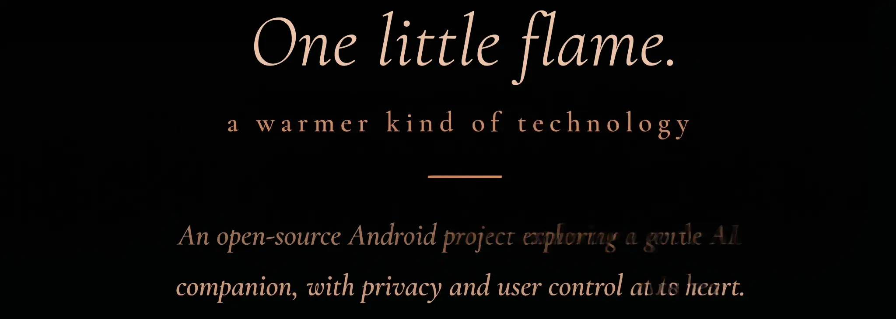

<div align="center">


<br/>
<picture>
  <source media="(prefers-color-scheme: dark)" srcset="docs/assets/glimmer-flame-definition-dark.png"/>
  <source media="(prefers-color-scheme: light)" srcset="docs/assets/glimmer-flame-definition-light.webp"/>
  
</picture>

<br/><br/>

[](LICENSE)
[](https://developer.android.com)
[](#-platforms)
[](#-platforms)
[](#-project-status)

### *"Not just an AI assistant — a friend that lives on your screen."*

[**Why**](#-why-glimmer-exists) · [**Status**](#-project-status) · [**Features**](#-features) · [**Companions**](#-companions) · [**Platforms**](#-platforms) · [**Architecture**](#️-architecture) · [**Getting Started**](#-getting-started) · [**GlimmerSoul**](#-glimmersoul-format) · [**Privacy**](#-privacy--safety) · [**Roadmap**](#️-roadmap) · [**Full plan**](ROADMAP.md) · [**Contributing**](#-contributing) · [**License**](#-license)

</div>

---

## ✨ What is Glimmer?

Glimmer is an open-source **AI companion layer**. It is a small living flame, an animated creature that floats above your apps, talks with you in your own language, keeps you company, and does things for you: opening apps, searching, setting reminders, and automating routine tasks.

You choose who lives on your screen: a calm sage, a playful trickster, a curious explorer, a gentle empath, and more. Anyone can build new companions with the open **GlimmerSoul** format.

Glimmer uses a **hybrid AI design**: small models run on your device for speed and everyday privacy, and a connected cloud service provides stronger reasoning, better translation and real-time information.

---

## 🚧 Project Status

Glimmer is **in early development**, built by one developer in spare time. There is **no public release yet**. Everything below is labelled honestly:

| Label | Meaning |
|:--:|---|
| 🚧 | In progress |
| ⚪ | Planned |
| 🔬 | Research: we want it, but it is not proven to be feasible yet |

If you are a developer, designer, translator, accessibility expert or AI researcher and you like this idea, you are very welcome. See [Contributing](#-contributing).

---

## 🕊️ Why Glimmer Exists

Many people now spend more time with screens than with other people. Children prefer games to playing outside, teenagers scroll instead of meeting, and chatting with an AI has become normal. Glimmer accepts that reality and tries to make the companion on the screen kinder, more useful and more respectful than what exists today.

It is built with particular groups in mind, because mainstream apps often forget them:

- People who live alone and want someone to talk to
- Children who need a patient, safe way to learn and play
- People with disabilities, who are still under-served by phone interfaces. The WHO estimates about 1.3 billion people live with a significant disability.
- Migrants and language learners. The UN estimates about 281 million international migrants.
- Anyone who wants a friendly, personal assistant instead of a cold one

Glimmer is not a doctor, therapist or lawyer, and it never claims to be. See [Safety](#-privacy--safety).

---

## ✨ Features

### Companion & personality

| Feature | Status |
|---|:--:|
| Animated flame companion that floats above your apps | 🚧 |
| 9 built-in companions with distinct personalities | 🚧 |
| GlimmerSoul: open format to create, share and export companions | 🚧 |
| Friendly chat: banter, stories, games, bedtime stories | ⚪ |
| Language practice in your target language, with gentle corrections | ⚪ |
| 100+ languages with automatic detection (quality varies by language; best with cloud) | ⚪ |
| Companion memory of your preferences, with a one-tap "forget" | ⚪ |

### Getting things done

| Feature | Status |
|---|:--:|
| Natural-language commands in many languages: "open Maps", "search for…", "set an alarm for 7" | ⚪ |
| Reminders, calendar and daily routines, including habit and medication-time reminders (reminders only) | ⚪ |
| Summaries of notifications and messages (opt-in; needs notification access) | ⚪ |
| Task automation and multi-step routines | ⚪ |
| Voice control and offline speech recognition (Whisper.cpp) | ⚪ |
| Draft replies for you to approve before sending | ⚪ |
| Phone tools on Android: duplicate photos, storage cleanup, permission audit | ⚪ |
| Elevated actions through [Shizuku](https://shizuku.rikka.app/), no root needed | ⚪ |

### Context & wellbeing

| Feature | Status |
|---|:--:|
| Context-aware suggestions (time of day, calendar, battery, long sessions) | ⚪ |
| Gentle check-ins, break reminders and late-night nudges | ⚪ |
| Daily gratitude and kindness prompts | ⚪ |
| Optional check-in summaries to trusted contacts, always visible to and controlled by the user | ⚪ |
| User-triggered emergency button that shares location with trusted contacts | ⚪ |

### Accessibility

| Feature | Status |
|---|:--:|
| Full voice control and screen reading | ⚪ |
| Large, simplified interface mode | ⚪ |
| Sign-language input from the camera | 🔬 |

### Culture, family & the world

| Feature | Status |
|---|:--:|
| Heritage Keeper: record family stories, dialects and proverbs as an opt-in archive | ⚪ |
| Pet and nature features: vet and feeding reminders, weather alerts, nature facts | ⚪ |
| Eco habit tracking (water, movement, simple carbon estimates) | ⚪ |
| Companion marketplace for community Souls | ⚪ |

> **Not a medical device.** Glimmer does not diagnose, monitor health conditions, interpret symptoms or give medication advice. Reminder features only remind you of what *you* or your doctor decided.

---

## 👾 Companions

Nine companions are planned for the first release. Each is a `.soul.json` file.

| Companion | Archetype | Speaks like | Best for |
|---|---|---|---|
| 🔵 **Nox** | The Wise Sage | Brief, precise | Focus, minimalists |
| 🟣 **Zuri** | The Trickster | Sarcastic, playful | Gamers, social people |
| 🟢 **Pip** | The Explorer | Excited, curious | Kids, creatives |
| 🔴 **Kael** | The Warrior | Direct, no fluff | Productivity, athletes |
| 🟡 **Luna** | The Empath | Soft, checks on you | Warm daily company |
| 🌿 **Gaia** | The Earth Guardian | Gentle, poetic | Nature, eco habits |
| ☀️ **Seraph** | The Child's Friend | Patient, playful | Children (with a parent or guardian) |
| 🏛️ **Elder** | The Keeper of Memory | Warm, nostalgic | Stories, family memories |
| 💊 **Dawa** | The Routine Helper | Calm, clear | Reminders and daily routines |

Same request, different companions: *"Remind me about the meeting at 3pm"*

```
🔵 Nox    →  "Meeting. 3 PM. Set."
🟣 Zuri   →  "Fine, I'll save you from forgetting again 😏 — done."
🟢 Pip    →  "Ooh a meeting! Reminder set! Want one 15 mins early too?!"
🟡 Luna   →  "Of course ❤️ — I'll remind you gently."
```

Anyone can add companions: see [GlimmerSoul](#-glimmersoul-format).

---

## 💻 Platforms

| Platform | Status | Notes |
|---|:--:|---|
| **Android 15+** | 🚧 | Primary platform: overlay companion, tasks, voice |
| **Windows** | ⚪ | Companion on the desktop plus PC control and automation |
| **Linux** | ⚪ | Same as Windows, starting with common desktop environments |
| **iOS / macOS** | ⚪ Later | After Android, Windows and Linux. Apple platforms restrict floating overlays and background access, so the experience will differ. |

---

## 🏗️ Architecture

Glimmer is a **hybrid** system:

```
┌─────────────────────────── Your device ───────────────────────────┐
│  Companion UI · Soul engine · Task router · Local memory (encrypted) │
│  Small local models: quick chat, language detection, speech (STT)   │
└───────────────┬───────────────────────────────────────────────────┘
                │  TLS 1.3 · only what each feature needs
┌───────────────▼───────────────────────────────────────────────────┐
│  Cloud service: stronger reasoning, translation, live information,   │
│  optional sync of your companion between devices                     │
└────────────────────────────────────────────────────────────────────┘
```

- **Local first for simple things.** Quick replies, commands and language detection use on-device models.
- **Cloud for hard things.** Complex reasoning, high-quality translation and sync use the cloud.
- **Model size follows your device.** Glimmer picks a local model that fits your RAM. Real benchmarks will be published once measured on actual devices.

### Repository layout

```
glimmer/
├── android/      # Kotlin app (overlay, tasks, voice)
├── desktop/      # Windows & Linux app (planned)
├── shared/       # AI bindings (llama.cpp, Whisper.cpp), Soul parser, language detection
├── souls/        # Built-in and community companions
├── docs/         # Architecture, plugin API, Soul format, privacy
└── skins/
```

### Tech stack

| Layer | Android | Desktop (Windows / Linux) |
|---|---|---|
| Language | Kotlin · C++ (NDK) | To be decided |
| UI | Jetpack Compose + custom Canvas | Transparent always-on-top window |
| Local AI | llama.cpp · ONNX Runtime | llama.cpp |
| Speech | Whisper.cpp | Whisper.cpp |
| Storage | Room + AES-256 + Android Keystore | Encrypted local store |
| Background | WorkManager + AlarmManager | System service / tray |
| System access | Shizuku (optional) | OS automation APIs |

---

## 🚀 Getting Started

### Android (current development target)

Prerequisites: Android Studio Jellyfish or newer · Android SDK 35+ · JDK 17+ · a device or emulator with Android 15+.

```bash
git clone https://github.com/glimmer-ai/glimmer.git
cd glimmer/android
./gradlew assembleDebug
./gradlew installDebug
```

First launch:

1. Grant the overlay permission (`SYSTEM_ALERT_WINDOW`) when prompted.
2. Complete the **Privacy Setup** and choose what Glimmer may access and what may use the cloud.
3. Tap **Summon Glimmer** and pick a companion.
4. Optionally enable [Shizuku](https://shizuku.rikka.app/) for system features.

Windows and Linux builds will be documented when they exist.

---

## 🧬 GlimmerSoul Format

A **GlimmerSoul** is a small JSON file that describes a companion. The format is open (**CC0**) so anyone can create and share companions.

```json
{
  "version": "1.0",
  "id": "luna",
  "name": "Luna",
  "archetype": "The Empath",
  "author": "Glimmer Core Team",
  "license": "CC0-1.0",
  "language": "auto",
  "avatar": { "shape": "flame", "colorPrimary": "#FFD54F" },
  "personality": { "humor": 0.5, "warmth": 1.0, "energy": 0.6, "formality": 0.2 },
  "skills": { "task_execution": 0.7, "emotional_support": 1.0, "ambient_awareness": 0.9 },
  "special_skill": { "id": "checkin_mode", "name": "Check-in Mode" },
  "responses": {
    "greeting": { "en": ["Hi there ❤️"], "ar": ["أهلاً بك ❤️"], "fallback": ["❤️"] }
  }
}
```

A Soul can define personality, skill weights, voice and vocabulary, a special mode, visual identity, multilingual responses and content filters for its intended audience.

To publish yours: follow [docs/GLIMMERSOUL_FORMAT.md](docs/GLIMMERSOUL_FORMAT.md) and open a PR to [`souls/`](souls/).

---

## 🔒 Privacy & Safety

Because Glimmer connects to a cloud service, here is exactly what that means.

### What we commit to

- **No selling of personal data.** This is a project policy and commitment. (Note that the open-source license alone does not enforce it.)
- **Data minimization:** each feature sends only what it needs.
- **Encryption:** TLS 1.3 in transit; AES-256 for data stored on your device.
- **Control:** see what is stored, export it in an open format, and delete it all with one action.
- **Granular consent:** cloud features, memory, sync and the Heritage archive are separate opt-ins you can revoke.
- **Open source:** the code can be audited, and modified network versions must publish their source (AGPL-3.0).

### Consent levels

| Level | Examples | Can be disabled? |
|---|---|:--:|
| Essential | Core on-device AI, UI | Required |
| Optional | Conversation memory, personalization | Yes |
| Cloud | Cloud AI, translation, sync, Heritage archive | Yes, per feature |
| Experimental | Beta features, research participation | Yes, off by default |

### Safety boundaries

- **No medical functions.** Glimmer is not a medical device and does not give diagnoses, symptom interpretation or medication advice.
- **Emergencies.** Glimmer is not an emergency service. The emergency button only shares your location with contacts *you* chose.
- **Children.** Seraph and child modes are designed to be used with a parent or guardian. Content filters are a design goal, not a guarantee.
- **Real life matters.** Glimmer can be your friend on the screen, and it will not guilt you for leaving, will not try to keep you engaged, and will remind you to take breaks.

### Legal status

Glimmer is **designed around GDPR-style principles** and aims to follow privacy laws such as GDPR, CCPA, LGPD, PIPL, DPDP, PDPL and KVKK. **No independent legal audit has been carried out yet.** One is planned before any public release, and the project will not claim compliance until it has been reviewed. When required by law, Glimmer will cooperate with authorities in the minimum way the law requires and will publish transparency reports.

An independent oversight board is a long-term goal, not an existing body.

---

## 🗺️ Roadmap

No dates are promised. This is one developer's plan, in order.

```
1. Foundation   Android overlay companion · 9 Souls · GlimmerSoul v1 · basic chat
2. Mind         Hybrid AI (local + cloud) · language detection · more languages
3. Hands        Commands, reminders, calendar, app control, automation · voice
4. Awareness    Context suggestions · wellbeing check-ins · notification summaries
5. Desktop      Windows and Linux companion · PC automation
6. Trust        Privacy Center · consent log · security review · legal review · first public release
7. Community    Soul marketplace · plugin API · translations
8. Humanity     Heritage Keeper · accessibility audit · NGO and school partnerships
9. More         iOS and macOS · wearables
```

---

## 🤝 Contributing

```
🐛  Bug report       → .github/ISSUE_TEMPLATE/bug_report.md
💡  Feature request  → .github/ISSUE_TEMPLATE/feature_request.md
🌍  Translation      → android/app/src/main/res/values-*/strings.xml
🧬  Publish a Soul   → souls/README.md
🔌  Build a plugin   → docs/PLUGIN_API.md
🖥️  Desktop help     → Windows and Linux builds (planned)
```

We especially welcome contributors who speak under-represented languages, work in accessibility, healthcare, education or humanitarian fields, or have felt left out by technology.

Please read [CONTRIBUTING.md](CONTRIBUTING.md) and [CODE_OF_CONDUCT.md](CODE_OF_CONDUCT.md) first.

**Code standards:** `ktlint` (Kotlin) · LLVM style (C++) · unit tests for new features · no third-party analytics · privacy review for any new data access.

---

## 📄 License

| Component | License |
|---|---|
| Application source code | [AGPL-3.0](LICENSE) |
| GlimmerSoul format spec | [CC0 1.0](souls/LICENSE) |
| Visual assets | [CC BY-SA 4.0](docs/assets/LICENSE) |
| Documentation | [CC BY 4.0](docs/LICENSE) |

**Why AGPL-3.0?** Anyone who modifies Glimmer and offers it as a network service must publish their changes. The project stays open.

**Original author & copyright holder:** Abdulhannan Abdulkerim · [@ALMLK1996](https://github.com/ALMLK1996)

---

<div align="center">

**✦ Glimmer — one little flame. A warmer kind of technology.**

*Built with ❤️ by one developer, and hopefully soon by many.*

</div>
